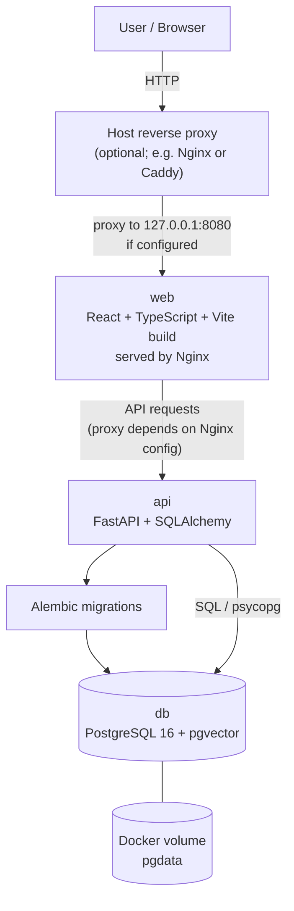
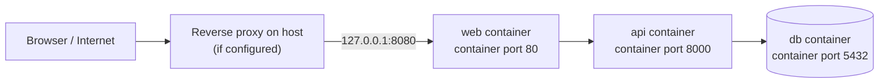
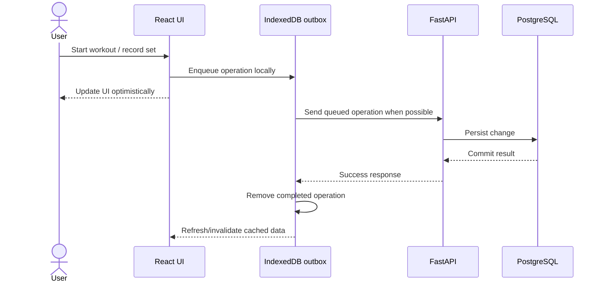

from pathlib import Path
import pypandoc

content = r'''# Gymlog


<p align="center">
  
  
  
  
</p>

Gymlog is a self-hosted workout tracker. The frontend is designed for offline-friendly interactions: changes can be queued locally and synchronized with the API when connectivity is available.

> **Architecture note:** The diagrams below describe the current Compose-based design. Production uses prebuilt images from GitHub Container Registry (GHCR); the database is persisted in a named Docker volume.

## Architecture at a glance



### Production networking



- The production Compose file publishes **only** `127.0.0.1:8080:80` for the web container.
- The API and database do not publish host ports in the production Compose file; they communicate over the Compose network.
- Because web binds to loopback, external access requires a host reverse proxy or an intentional change to the port binding.
- The web-to-API path depends on the Nginx/frontend API configuration included in the deployed web image.

## Technology stack

| Layer | Technology | Responsibility |
|---|---|---|
| Frontend | React + TypeScript | Workout screens and user interactions |
| Frontend build | Vite | Development server and production build |
| UI localization | i18next / react-i18next | English and Persian UI; RTL support |
| Web serving | Nginx | Serves the built frontend |
| API | FastAPI | HTTP API |
| Data access | SQLAlchemy + psycopg | Python ORM and PostgreSQL connectivity |
| Schema changes | Alembic | Database migrations |
| Database | PostgreSQL 16 + pgvector | Persistent application data and vector extension support |
| Offline behavior | IndexedDB + `idb-keyval` | Local outbox and persisted client data |
| Client data/cache | TanStack Query | API query cache and invalidation |
| Containers | Docker Compose | Local and production service orchestration |
| Image registry | GitHub Container Registry (GHCR) | Stores production API and web images |

## Offline-first request flow



The outbox currently handles workout and set operations such as starting/finishing a workout, starting a set, and updating a set. Pending operations can be retried when the browser comes online or becomes visible again.

## Services

### `web`

- Production image: `ghcr.io/imansabet/gymlog/web:${IMAGE_TAG:-latest}`
- Serves the frontend through Nginx on container port `80`.
- Production host binding: `127.0.0.1:8080:80`.

### `api`

- Production image: `ghcr.io/imansabet/gymlog/api:${IMAGE_TAG:-latest}`
- Runs Alembic migrations before starting Uvicorn.
- Listens on container port `8000`.
- Healthcheck: `GET /health/ready`.

### `db`

- Image: `pgvector/pgvector:pg16`
- Uses environment variables `POSTGRES_USER`, `POSTGRES_PASSWORD`, and `POSTGRES_DB`.
- Stores PostgreSQL data in the named volume `pgdata`.
- Uses `pg_isready` for its healthcheck.

## Local development vs. production

| Concern | Local Compose | Production Compose |
|---|---|---|
| API and web images | Built from local source | Pulled from GHCR |
| Database | PostgreSQL + pgvector | PostgreSQL + pgvector |
| API host port | Defined by the development Compose file | Not published |
| Web host port | Defined by the development Compose file | `127.0.0.1:8080` |
| Persistent database | Named Docker volume | Named Docker volume scoped to `gymlog-prod` |
| Startup behavior | Development Compose configuration | Health-gated startup and restart policies |

Production Compose uses `name: gymlog-prod`, so its named volume is separate from a volume created by a differently named development Compose project. Do not assume the two environments share the same database.

## Production deployment

The deployment script is `deploy/deploy.sh`. From the repository root, it can be run with:

```bash
cd deploy
./deploy.sh
```

The script performs these steps:

1. Pulls the images referenced by `docker-compose.prod.yml`.
2. Starts or updates services in detached mode and removes orphan containers for this Compose project.
3. Prunes dangling Docker images.
4. Prints the status of the production services.

The script uses `docker` without `sudo`; ensure the deploying user has permission to access the Docker daemon.

